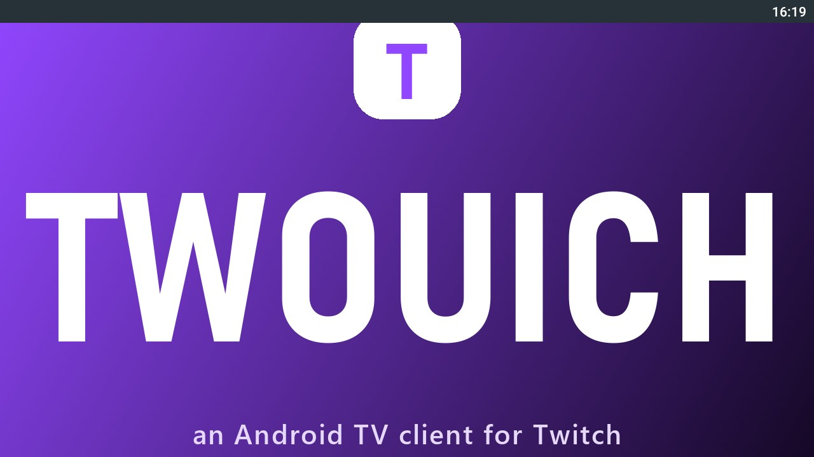
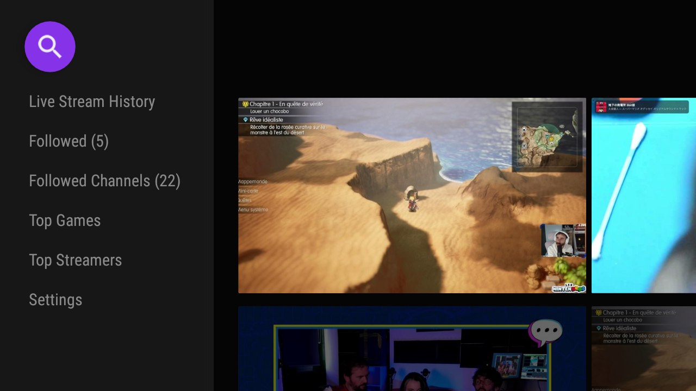

# Twouich

[](https://github.com/Endymi0n74/Twouich/actions/workflows/build.yml)
[](https://github.com/Endymi0n74/Twouich/releases/latest)

[🇫🇷 Français](README.md) · **🇬🇧 English**

Android TV client for Twitch, with local filtering of SSAI ad markers, VOD un-muting and VaFT anti-ad fallback.

> Independent project, not affiliated with Twitch Interactive, Inc.





## Features

- **Local SSAI**: removes `stitched-ad` / `Amazon` / `CUE-OUT` before ExoPlayer playback (`PlaylistSanitizer`, `AdBlockDataSource`)
- **Un-muted VOD** `v1.0.16`: `-unmuted` → `-muted` on `cloudfront` playlists (original audio, from `TwVodNoAdsJCed`)
- **VaFT fallback** `v1.0.16`: if `stitched-ad` survives stripping (new format), attempt clean stream `GQL PlaybackAccessToken embed` → `usher v2` → variant (5s timeout, fallback to stripping) (`VaftFallback`, dormant while `lastCut>0`)
- **Reproducible build**: canonicalized ZIP (timestamp + order), `SELFTEST 31/31`, `check-release.sh` 4/4

## What's new in v1.0.24 — October 24, 2026

- **Watch points arrive on phones.** One minute watched is one point, per channel, shown in a badge at the top left of the video (`0 pt`, `12 pts`). Everything stays on the device, in the app's private preferences: no Twitch session is needed and nothing is sent anywhere. The counter follows playback (refreshed every 15 s) and picks up where it left off after an update.
- **The player and the channel page adopt Twitch mobile's language.** Phone only: chat panel on a dark surface with rounded top corners and 8 dp of breathing room under the video, circular picture-in-picture button, pill-shaped message field, channel page on a dark surface with a round avatar and pill buttons. Television keeps its original rendering, checked resource by resource (`layout-sw600dp`, `layout-sw540dp`, `layout-television`) and on screen at 1920×1080.
- **The player's lists lose their square corners.** Quality, volume, playback speed and VOD chapters go from 2 dp — invisible to the eye — to 14 dp: the panels opened over the chat finally read as cards. The radius is applied on phones only; TV gets its original 2 dp back.
- **The anti-ad fallback no longer serves the raw playlist.** Seven conditions were inverted in the fallback: when the main filter failed, the app handed back the advertising playlist as-is. Measured on a real pod: 2 578 bytes replaced by 15 674 bytes of clean content, `ads_out=false`. The channel is now known as soon as the player opens — deep links included — so the fallback does not have to guess it.
- No message was sent and no session was lost during validation (`adb install -r`).

## Installation

Download [`Twouich_v1.0.24.apk`](https://github.com/Endymi0n74/Twouich/releases/download/v1.0.24/Twouich_v1.0.24.apk) from the published release.

```bash
adb install -r Twouich_v1.0.24.apk
```


## Source project and credits

Twouich is based on the original [S0undTV](https://github.com/S0und/S0undTV) project. Thanks to its authors and contributors for the initial work and the libraries used.

This repository only redistributes patched binaries and the associated patches; it does not redistribute the original source code. See [`CREDITS.md`](CREDITS.md) for details.


## Limitations

Filtering depends on the current format of Twitch ad markers. Sub-only VODs are only played if a token cached on the app side is still accepted by `usher` (server behaviour, observed on sub-only VODs). The VaFT fallback only kicks in when stripping fails, and falls back to local stripping on network errors.
